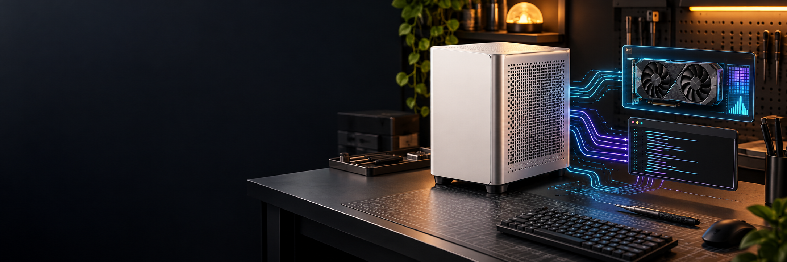
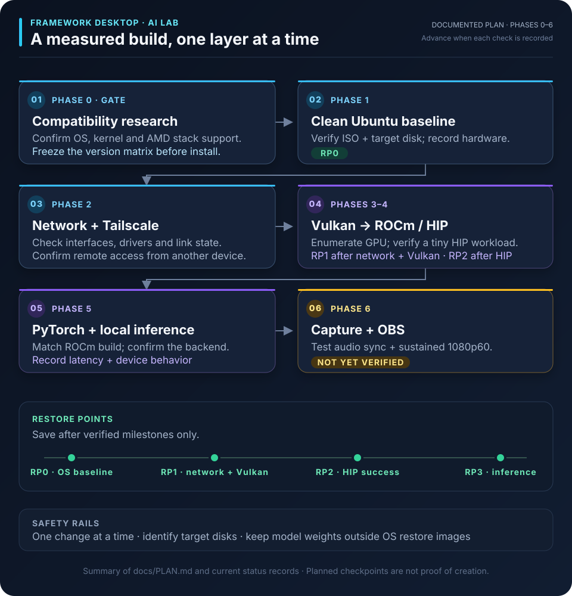

# Framework Desktop AI Lab

  <strong>Build notes for a local AI workstation, tested one layer at a time.</strong> 
  AMD Ryzen AI Max+ 395 · Framework Desktop · Ubuntu Desktop

  
  
  
  

A reproducibility-focused, OPSEC-conscious record of bringing up a Framework Desktop with local inference, GPU compute, remote access, backups, and capture hardware. The workstation build is specific to the hardware above; the Ollama + Tailscale proxy documentation is being organized as a reusable deployment pattern for compatible Linux hosts.

> [!IMPORTANT]
> **Proxy beta: community testing is open for v0.1.0-beta.1.** Local proxy discovery and non-streaming inference passed. Tailscale HTTPS `/api/tags` returned HTTP 200 after cutover, and an Android OpenAI-compatible client completed a basic prompt and response. A clean completed streaming test, startup after reboot without login, and backup restoration remain unverified. The guide has not yet been independently reproduced on a clean machine.
>
> Start with the [generic Linux proxy beta guide](docs/OLLAMA_TAILSCALE_PROXY_GUIDE.md). See the [platform profiles and compatibility boundaries](docs/PROXY_PLATFORM_PROFILES.md), [beta notes](docs/RELEASE_NOTES_v0.1.0-beta.1.md), [proxy operations](docs/LLM_PROXY_OPERATIONS.md), and [latest status log](docs/STATUS_2026-10-26.md).

## At a glance

| Area | Current record |
| --- | --- |
| **Workstation platform** | Framework Desktop · Ryzen AI Max+ 395 · Ubuntu 26.04.1 LTS |
| **GPU compute** | ROCm/HIP smoke test passed for `gfx1151`; Vulkan enumerates the Radeon GPU |
| **Local inference** | Ollama loaded `qwen3:8b`; GPU placement reported at 100% in the observed test |
| **Image generation** | ComfyUI 0.43.0 started on the AMD HIP backend; Z-Image model discovery corrected |
| **Remote access** | Tailscale HTTPS proxy endpoint and a basic Android client request verified |
| **Backups** | Encrypted backup checksums verified; restore not tested |
| **Capture** | UGREEN capture workflow and sustained 1080p60 behavior remain unverified |

The proxy results above were observed on the Framework Desktop test host. They are not proof that the procedure has been tested on other Linux distributions or hardware. Only observed results are marked as passes.

## Follow the build

The project verifies each layer independently, then records what worked and what still needs testing.

[Open the workflow diagram at full size](docs/assets/build-workflow-v2.svg)

Restore points are planned at validated milestones; their placement in the diagram does not imply that a checkpoint has been created. See the [full build plan](docs/PLAN.md) and [latest status log](docs/STATUS_2026-10-26.md).

## Documentation

<strong>Workstation setup and validation</strong>

| Guide | What it covers |
| --- | --- |
| [Plan](docs/PLAN.md) | Phased build plan |
| [Compatibility](docs/COMPATIBILITY.md) | Hardware and software compatibility notes |
| [Baseline](docs/BASELINE.md) | Known system baseline |
| [Installation record](docs/INSTALLATION_RECORD.md) | Retained commands and observations |
| [GPU validation](docs/GPU_VALIDATION.md) | Vulkan, ROCm/HIP, and PyTorch checks |
| [Networking and Tailscale](docs/NETWORK_AND_TAILSCALE.md) | Network and remote-access notes |
| [Restore points](docs/RESTORE_POINTS.md) | Backup and restore strategy |
| [Streaming](docs/STREAMING.md) | Capture card and OBS validation |
| [Sources](docs/SOURCES.md) | Official references |
| [Test log template](docs/TEST_LOG_TEMPLATE.md) | Consistent test records |

<strong>ComfyUI image generation on AMD ROCm</strong>

| Resource | What it covers |
| --- | --- |
| [ComfyUI on Framework Desktop](docs/COMFYUI_ROCM_SETUP.md) | AMD HIP startup, model placement, private Tailscale Serve access, validation status, and troubleshooting |
| [Model sorter](scripts/comfy-model-sort) | Exact-name model organizer with dry-run and no-overwrite behavior |
| [Download watcher](scripts/comfy-model-watch) | inotify-based Downloads watcher |
| [User service](systemd/comfy-model-watch.service) | systemd user unit for automatic sorting |
| [Desktop manager](apps/comfy-model-manager.py) | Tkinter GUI for service controls, sorting, folders, and logs |

The ComfyUI record distinguishes successful server startup and model discovery from a completed image-generation test. Private tailnet names/IPs and model weights are not stored in this repository.

<strong>Local inference proxy beta</strong>

| Guide | What it covers |
| --- | --- |
| [Generic Linux Ollama + Tailscale proxy guide](docs/OLLAMA_TAILSCALE_PROXY_GUIDE.md) | Prerequisites, setup, local checks, Tailscale cutover, Android configuration, troubleshooting, and rollback |
| [Platform profiles](docs/PROXY_PLATFORM_PROFILES.md) | What is generic, what was tested on AI Max, and what remains unverified elsewhere |
| [Proxy operations](docs/LLM_PROXY_OPERATIONS.md) | Operations and rollback reference |
| [v0.1.0-beta.1 notes](docs/RELEASE_NOTES_v0.1.0-beta.1.md) | Beta scope and limitations |
| [NGINX example](examples/nginx/ollama.conf) | Example reverse-proxy configuration |
| [Rootless Quadlet example](examples/quadlet/llm-proxy.container) | Example systemd Quadlet container |

<strong>Proxmox home lab proposal</strong>

This is a **planning track** for a proposed six-node Proxmox monitoring and multi-agent development design. The monitoring dashboard and agent workflow are not deployed.

| Plan | What it covers |
| --- | --- |
| [Monitoring architecture](docs/HOMELAB_MONITORING_ARCHITECTURE.md) | Proposed topology and security model |
| [Implementation plan](docs/HOMELAB_IMPLEMENTATION_PLAN.md) | Phases and verification criteria |
| [Agent workflow](docs/HOMELAB_AGENT_WORKFLOW.md) | Proposed coding, independent review, testing, and human approval |

## Working principles

- Change one thing at a time and record observed results.
- Change GPU drivers and inference backends only after checking the target platform's official compatibility information.
- Review destructive disk operations and positively identify target disks.
- Never publish credentials, device keys, private IP maps, MAC addresses, serial numbers, or unredacted logs.
- Keep model weights and caches outside OS restore images.
- Use `$HOME` and `$XDG_CONFIG_HOME` instead of personal hard-coded paths.
