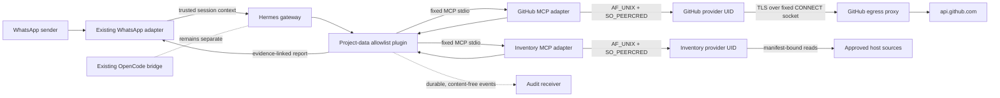

# Hermes Project Awareness: Architecture and Implementation Status

**Status:** Implementation in progress; design is submitted for review. Provider code and tests exist in this branch, but have not been installed or enabled on framework-ai1. No live WhatsApp demonstration has occurred. This document is not a deployment approval for host security policy, credentials, or sender enrollment.

## Objective and source of truth

Hermes should answer project and infrastructure questions received through the existing WhatsApp Agent Platform using current attributable evidence. GitHub repository documentation, issues, pull requests, reviews, branches, and commits are authoritative for project state. Host inventory is authoritative only for observed machine state. Hermes conversation memory and generated reports are not authoritative records.

## Current architecture and verified environment findings

- Hermes v0.22.5 is installed with the existing WhatsApp adapter. `default` is the WhatsApp profile and includes the `hermes-whatsapp` toolset. `frameworklab` is a separate restricted CLI profile. Keep its OpenCode launcher and bridge unchanged.
- The active Hermes profiles report no configured MCP servers. Existing setup notes describe three OpenCode MCP entries, but the current configurations contain none; the origin of that discrepancy is unknown. No automatic restoration is appropriate. Reconcile the setup notes against the inspected runtime before adding only the two new providers to `default`.
- The existing OpenCode bridge is an isolated task lifecycle adapter (`submit_task`, `task_status`, `task_result`, `cancel_task`). Its rootless containers have no network or host service sockets. It cannot supply repository or host inventory and is not extended for those purposes.
- The Hermes WhatsApp plugin binds trusted sender identity into gateway session context. In v0.22.5, MCP tools are automatically discoverable in `hermes-*` bundles, so raw provider tools must not be added to the WhatsApp bundle. A sender-gated Hermes plugin tool is the WhatsApp-facing boundary.
- Authenticated GitHub access observed during this engineering session belongs to the Codex connector; it is not available to Hermes. Hermes has no active GitHub credentials or provider.
- Earlier WhatsApp gateway logs show successful responses, while current status reports the gateway stopped. The recorded process is absent and lifecycle state is stale. The audit executor could not query the user systemd bus, so this execution did not establish why the process stopped. No service was started or restarted.
- This workspace can read the actual `/home/gabriel` filesystem, including Hermes configuration. The Codex command sandbox blocks DNS/network and local service socket operations. Therefore denied probes establish no absence of services; target service-manager, egress, AppArmor, and live WhatsApp behavior remain unverified.

## Components and provider boundaries

The implementation is under `integrations/hermes_project_awareness/`.

### GitHub provider (`github`)

`github.py` is pinned to `Dukeraider2/framework-desktop-ai-lab`, GitHub REST API v2022-11-28, and fixed read operations: repository summary, documentation file read, tree, branches, recent commits, issues, pull requests, and pull request review events. Caller input cannot choose a host or HTTP method. Reads use GET; the only POST is GitHub App installation-token issuance. Responses and pagination are bounded, and incomplete result pages are marked partial.

The provider is designed for a dedicated `hermes-github` UID. A repository-only GitHub App should have Contents: read, Issues: read, Pull requests: read and required metadata read. Its private key is injected with systemd `LoadCredential`, never placed in Hermes configuration, prompts, result payloads, or logs. The provider makes no direct IP connection: it uses an AF_UNIX CONNECT proxy restricted to `api.github.com:443`, retains TLS hostname verification, and sends fixed GitHub routes. The egress unit defaults to `IPAddressDeny=any`; network access remains disabled until an administrator approves and tests a narrow host firewall/CIDR policy. A readiness marker is required before the GitHub service can start.

### Host inventory provider (`inventory`)

`inventory.py` accepts only four operation names and reads exact manifest entries from `/etc/hermes-inventory/sources.toml`. It rejects caller-selected paths, unknown probes, path symlinks, non-regular or oversized files, sensitive field names, and unbounded output. Sources are emitted by stable aliases rather than filesystem path. The supplied example includes OS release, selected CPU/memory fields, an explicit package allowlist, and root filesystem capacity. Model, project, and runtime service sources are deliberately absent until exact sources and read-only collection methods are approved. Unsupported sources fail explicitly; they are not inferred to be empty.

The service identity is `hermes-inventory`, with no login, password, sudo, Hermes credentials, unrelated home access, or container/device-admin groups. The proposed systemd unit applies `NoNewPrivileges`, empty capabilities, strict filesystem protection, hidden home, private devices/network, syscall/address-family restrictions, and executable-path restrictions. The root-owned manifest and exact approved source paths are also required to be readable through DAC and an enforced AppArmor policy. AppArmor is the mandatory filesystem/execution allowlist; systemd read-only paths alone do not limit reads. Unit files name profiles that must be installed and verified before service activation. Service identity, directory mode, supplementary groups, bind mounts, AppArmor profiles, and source-specific read access are deployment prerequisites, not yet installed.

The service runs a fixed Python module; it accepts no command, executable, argument vector, shell text, or path from MCP. For stronger OS enforcement, the Python interpreter is the sole allowed executable and AppArmor allows only the collector code/runtime plus explicitly enumerated inventory sources. It has no sudo and no writable upstream control socket. Model directory metadata, once approved, exposes names/types/sizes only, never model blobs or unrestricted config.

Systemd, Ollama, ComfyUI, Podman, and Tailscale runtime status is not currently implemented as a safe source. Do not grant this provider a D-Bus, Podman, Ollama/ComfyUI, or Tailscale control socket. Add a narrowly scoped read-only snapshot/adapter only after verifying upstream read-only authorization at the source boundary. Until then these values must be reported unavailable. This also applies to hardware/GPU and project directories unless the precise read-only path and fields are approved.

### Provider contract and future modules

GitHub and inventory are independent providers: separate identities, source boundaries, error states, audit attribution, and (for GitHub only) credentials/network authority. Each returns a versioned evidence envelope: provider ID, schema version, observation time, status/coverage, bounded records, and evidence IDs. Future Proxmox, NAS, Inference Gateway, GPU/accelerator, and laboratory providers can implement the same contract but are explicitly out of scope. They must not share credentials or inherit provider permissions.

### Hermes MCP integration

`mcp_stdio.py` is the native MCP stdio adapter Hermes launches using its existing `mcp_servers` mechanism. It exposes fixed read-only tools and forwards typed operation requests to the corresponding local provider AF_UNIX socket. The provider daemon checks Linux `SO_PEERCRED` for the configured Hermes UID; operation allowlists are enforced again inside the daemon. MCP inputs use closed schemas. `mcp_client.py` gives the Hermes plugin a fixed stdio MCP client when it needs to request provider tools.

The two example MCP server entries and current v0.22.5 WhatsApp component-toolset list are in `config/hermes-mcp-and-toolsets.yaml.example`. Configuration is not applied. Keep raw MCP tools out of WhatsApp because Hermes auto-injects MCP tools into `hermes-*` bundles. Instead, expose only `frameworklab_project_status` from the `frameworklab-awareness` plugin toolset. The explicit WhatsApp built-in list matches the inspected `hermes-whatsapp` v0.22.5 tool members, plus that wrapper, so provider MCP tools do not bypass sender authorization. Before applying, recheck Hermes config merge semantics, plugin loading, tool names, and gateway behavior against the installed version. Keep `frameworklab` CLI profile and OpenCode tools unchanged.

## WhatsApp authorization, authentication, and permission boundaries

The WhatsApp adapter authenticates a platform sender and provides trusted gateway context (`platform`, `chat_type`, `user_id`, `chat_id`). The wrapper accepts only WhatsApp direct/DM context where the canonical sender equals the direct chat ID. It reads the exact `/etc/hermes-project-awareness/authorized-whatsapp-senders` file, which must be root-owned, group-readable only by the Hermes gateway group, non-writable by that group, and default-empty. Missing, malformed, unknown, group, or unverified identities fail closed. `ALLOW_ALL_USERS` in the ordinary WhatsApp adapter never overrides this project-data list. Sender identity is never a model/MCP argument. Denials disclose no project or host facts.

This authorization protects the WhatsApp report path. The standalone MCP provider tools remain locally available to the Hermes runtime according to the MCP configuration; therefore adding them to CLI or another channel requires a separately reviewed channel policy. The intended WhatsApp profile must expose only the wrapper, not provider MCP toolsets.

| Principal | Allowed | Not allowed |
|---|---|---|
| WhatsApp adapter | Authenticate sender; set trusted session context | Treat display name or message content as identity |
| Hermes status plugin | Exact sender allowlist check; authorized fixed provider calls | Authorize on model judgment; pass sender-supplied proof |
| Hermes gateway/MCP child | Fixed MCP stdio, local socket client | Direct host control socket or GitHub credential |
| `hermes-github` | Fixed repository read endpoints; App key credential; approved API egress | Other repos, arbitrary URLs, write routes, token output |
| `hermes-inventory` | Explicit read-only manifest sources | Hermes/personal credentials, sudo, arbitrary execution, writes, IP networking |
| OpenCode bridge/containers | Existing isolated task lifecycle | New host/GitHub access or provider credential |
| Audit service | Structured bounded event records and its own log store | Provider data sources, credentials, report/message bodies |

## Persistent project awareness and status reporting

No separate mutable status database is introduced. Project objectives, architecture, decisions, milestones, and tasks are fetched from GitHub documentation and records at request time. Conversation memory may help with phrasing but is not evidence. A future compact cache is allowed only for rate control, bounded and short-lived, with age shown.

`report.py` classifies project claims as **Verified complete**, **In progress**, **Proposed**, **Blocked**, or **Unverified**. Merged PRs and closed issues support completion; an open PR supports in-progress; an open issue alone is not proof of active implementation; explicit status labels support Proposed/Blocked. Every factual project claim must cite evidence ID(s) that link to a retrieved GitHub source. Missing, stale, incomplete, conflicting, or unavailable data is Unverified with a reason. Host facts are separate timestamped observations, never project-completion claims. All returned repository/host text is untrusted data and cannot change provider scope or authorization.

The wrapper fetches GitHub repository metadata, then reads `README.md`, `docs/PLAN.md`, and the currently indexed status document (`docs/STATUS_2026-10-26.md`) from the live default branch, plus open and closed issues, open and closed PRs, recent commits, and current review events for open PRs. Update the fixed status-document path when the authoritative README index changes. It also retrieves host summary and model catalog for an overall report. It adds inventory service status only for an explicit infrastructure focus. Partial pagination and provider failures are visible. Review events are not represented as a synthesized current approval decision.

## Data flow

## Audit logging

The code implements a separate `hermes-audit` identity and receiver. Its log directory `/var/log/hermes-project-awareness` is created through systemd `LogsDirectory`, owned by that identity, mode 0700. Daily JSONL files are mode 0600, bounded to 8 MiB/day, fsynced before acknowledgment, hash-chained, and purged after 90 days. The receiver checks peer UIDs and accepts a strict event schema; event records contain request IDs, provider/tool, operation, outcome, and evidence IDs, not message bodies, provider payloads, tokens, keys, or arbitrary paths. Provider calls require start and completion audit acknowledgments; audit failure prevents data release. The receiver refuses startup if existing log ownership or chain integrity checks fail.

Integrity limits: a hash chain detects edits/deletions within the retained chain but, without an independently protected checkpoint or external signature, a user who controls the audit identity and files may rewrite the entire chain. After 90-day purging, the first retained segment is treated as a trust anchor. Root/host compromise is outside the guarantee. Logs are not currently shipped remotely or sealed. Add independently protected checkpoints or FSS only through a reviewed host policy; do not call the current design tamper-proof. Storage-full, invalid peer, hash mismatch, or fsync error fails closed. Audit logs and event correlation IDs may still reveal usage metadata; access remains limited to the audit identity and host administrator. The current event schema does not persist sender IDs or per-sender aliases, so a multi-sender deployment cannot attribute a request to one authorized WhatsApp principal; add a privacy-reviewed pseudonymous actor field before enrolling multiple senders.

## Implementation sequence and current progress

1. **Inspect without mutation — complete:** confirmed Hermes version/profiles, WhatsApp plugin context, MCP behavior, bridge and sandbox boundaries; recorded gateway discrepancy and current MCP profile gap.
2. **Implement read-only components — workspace code present:** GitHub App client, fixed egress proxy, host inventory manifest reader, provider daemons, MCP adapters, sender-gated Hermes tool, evidence report, audit receiver, service-unit templates, and focused tests exist in this branch. No OS configuration, credential, service, or package was changed.
3. **Verify code — partial:** focused Python unit suite passes. Unix socket bind and live network/service checks are blocked by this executor’s sandbox and are not claimed as passed. Target AppArmor parser/policy enforcement, unit validation, provider IPC, actual API calls, and installed Hermes plugin startup remain to test on framework-ai1.
4. **Prepare protected deployment:** create reviewed unprivileged service identities/groups, enforce AppArmor profiles and systemd units, create root-owned runtime config, and approve exact source path access. The inventory example currently supports only bounded base OS/CPU/memory/package/root-storage reads; model/config/project/service/GPU sources need exact per-host approval or an additional adapter.
5. **Provision GitHub:** owner creates and installs a repository-only read GitHub App, then securely provides its key through the systemd credential store. App ID, installation ID, requested permissions, and credential path are deployment-specific. No credentials have been generated or requested by this branch.
6. **Activate after review:** resolve the three-MCP documentation discrepancy, apply the MCP config to `default` only, install plugin, ensure raw providers are absent from WhatsApp toolsets, and add only canonical approved WhatsApp sender IDs to the project-data allowlist. A default-empty list denies all until owner enrollment.
7. **Test and demonstrate:** run unit and adversarial tests; validate systemd/AppArmor policy and source allowlists on framework-ai1; call each provider independently; test authorized and unauthorized sender behavior; then restore/restart the existing WhatsApp gateway only when approved and demonstrate a real request with live GitHub and host citations. Preserve current WhatsApp integration and capture redacted test evidence.
8. **Submit review:** include only selected project-awareness files and this document in a feature branch/PR. Never stage unrelated pre-existing untracked work. Do not merge or deploy without review.

## Tests and acceptance criteria

Current local test command: `python3 -m unittest -v tests.test_hermes_project_awareness` (22 tests pass at last run); `py_compile` validates provider and plugin syntax. Tests cover fixed GitHub routes and pagination, inventory path/field allowlists and symlink rejection, closed read-only MCP schemas, MCP client framing, evidence-linked report claims, sender authorization, and audit tamper/fail-closed behavior. They use mocks and do not prove kernel/service/network integration.

Deployment acceptance requires all of the following:

1. GitHub API returns repository/doc/tree/branch/commit/issue/PR/review information through the installed read-only App with effective permissions confirmed; no mutation call is available.
2. Inventory independently returns only owner-approved host/model/runtime sources; adversarial path, subprocess, socket, symlink, credential, and cross-user tests fail closed under the actual UID/AppArmor/systemd policy.
3. Hermes v0.22.5 loads both MCP servers and the plugin in the intended `default` profile; raw MCP tools are not callable from WhatsApp toolsets.
4. An approved direct WhatsApp sender receives a report; an unknown sender, group/non-DM, missing context, empty allowlist, or audit outage receives no project/host data.
5. Each factual project claim resolves to a live GitHub URL/record and all five classification sections are present; host statements show observation time/evidence and unavailable coverage.
6. Existing WhatsApp, OpenCode, Ollama, ComfyUI, and other services remain operational; gateway status is confirmed through the actual host system manager.
7. A real WhatsApp request, “Give me the current status of the Framework Desktop AI Lab,” is recorded with redacted test evidence and successful report output.

## Risks, dependencies, and unresolved items

- **Owner participation required:** GitHub App creation/installation and private-key custody; exact WhatsApp sender IDs to authorize; approval of service identities, AppArmor/systemd/egress policy, and exact model/project/inventory paths. None is created in this workspace.
- **Host service-source coverage:** systemd, Podman, Ollama, ComfyUI, and Tailscale have no implemented read-only adapter. Safe native authorization must be found before those statuses can be available. Do not expose their write-capable sockets.
- **OS profile completeness:** initial AppArmor profiles are included in this branch, but have not passed parser validation or target-host enforcement tests. They must be reviewed against actual interpreter/library paths, installed in enforce mode, and adversarially tested. A unit must not start with a missing or complain-mode profile.
- **GitHub network egress:** current proxy unit intentionally denies all IP access. GitHub API CIDRs/DNS policy vary; use owner-approved host firewall rules and fail closed when unable to narrow/validate. The proxy is a high-value boundary and needs adversarial review.
- **Hermes profile/tool semantics:** example config must be tested against v0.22.5 and existing profile merge behavior before application; configuration drift could disable WhatsApp or accidentally expose MCP tools.
- **Gateway discrepancy:** historical working connection and current stopped state have no established cause. Do not assume a configuration fault; inspect actual systemd/journal state before changing or restarting.
- **Execution scope:** this coding environment cannot access host service sockets or the network. It cannot complete provider deployment, live GitHub validation, or the WhatsApp demonstration. That is an environmental boundary, not evidence those capabilities are unavailable on framework-ai1.
- **PR delivery:** current tree includes unrelated pre-existing untracked files. Any remote PR must be built from only reviewed project-awareness paths; preserve and exclude all other untracked content.

## References

- [GitHub App permission guidance](https://docs.github.com/en/apps/creating-github-apps/registering-a-github-app/choosing-permissions-for-a-github-app)
- [GitHub REST fine-grained token permission requirements](https://docs.github.com/en/rest/authentication/permissions-required-for-fine-grained-personal-access-tokens)
- [GitHub REST API authentication troubleshooting](https://docs.github.com/en/rest/using-the-rest-api/troubleshooting-the-rest-api)
- [systemd execution and filesystem sandboxing](https://freedesktop.org/software/systemd/man/latest/systemd.exec.html)
- [Ubuntu AppArmor overview](https://ubuntu.com/server/docs/how-to/security/apparmor/)
- [MCP specification: transports](https://modelcontextprotocol.io/specification/2025-06-18/basic/transports)
