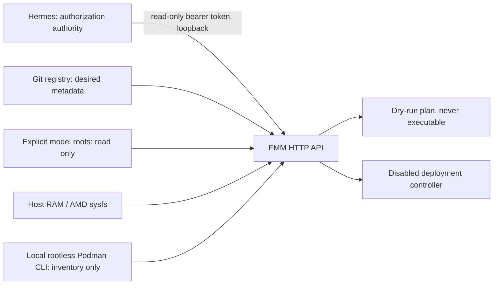

# Framework Model Manager — read-only first deliverable

FMM implements the first deliverable of [Issue #11](https://github.com/Dukeraider2/framework-desktop-ai-lab/issues/11). This is a development prototype, not a deployed service. Hermes retains administrative and orchestration authority. No model load, unload, switch, download, deletion, compression, provider activation, gateway edit or host command is exposed by the API.

The Python standard-library implementation adds no packages. It is independent of Ollama, llama.cpp, ComfyUI, Hermes and OpenCode. Existing service definitions and endpoints are unchanged. PR #10 remains separate and must not be merged or overwritten by this work.

## Architecture and trust boundary



The registry is loaded and validated at startup; updates require Git review and a later FMM restart. Discovery never edits the registry or promotes lifecycle status. The starter registry deliberately uses `Catalogued`, `enabled: false`, unknown integrity/memory/runtime facts and no private storage paths. It is not a claim that observed files are complete, qualified or callable. See [manifest schema](manifest.schema.json) and [API contract](openapi.json). Duplicate registry IDs are also rejected by the Python validator.

Operator-controlled scan roots are supplied at launch. HTTP callers cannot supply filesystem paths, shell commands, URLs, ports, Podman arguments or registry updates. GGUF discovery reads the four-byte magic; this is identification, not structural validation. It skips symlink roots, directory symlinks, file symlinks and nonregular files. Hardlinks/overlapping roots are deduplicated by device/inode; separate copies need opt-in SHA256 to deduplicate. Hashing checks size/mtime stability and can cause substantial disk I/O. No hashing occurs through HTTP. Model directories should be trusted and mounted read-only; this scanner is not a security boundary against concurrent hostile directory replacement.

RAM comes from `/proc/meminfo` (`MemAvailable`), storage from `statvfs`, GPU VRAM/GTT and activity from AMD sysfs. Missing telemetry stays null. GPU GTT shares system RAM on Strix Halo; it is never added to RAM headroom. Activity readings are sensor observations, not proof of idle capacity. Podman queries use fixed argument lists, no shell, force local mode, strip remote connection environment variables, require a nonroot user and verify rootless identity before listing containers, stats and volumes. Responses exclude commands, labels, environment and mount paths. Timeouts and failures report unavailable rather than attempting permission or service repair. Stats remain the runtime's formatted measurements, not a per-model complete memory budget.

Every HTTP route, including health and audit, requires a bearer token. The server binds only to literal `127.0.0.1`; there is no external-bind option. Provision a random token of at least 32 ASCII characters through an approved secret mechanism into `FMM_API_TOKEN`; do not place its value in Git, URLs or command arguments. This token grants read-only visibility and planning to its holder; it does not establish a Hermes identity or confer lifecycle authority. Do not distribute it to general agents. Responses may contain local model paths/IDs; treat inventories as private.

Browser Origin requests are rejected; CORS is not enabled. Bodies are JSON-only, capped at 4096 bytes, with a single Content-Length and no Transfer-Encoding. Connections time out after five seconds. Requests are serialized by the single-process HTTP server. Audit stores time, known operation, method and result status in a bounded 1000-event memory buffer, never headers or bodies. Audit is lost at exit and is unsuitable for lifecycle authorization evidence. No audit file or secret is written.

Python's `http.server` is a local development interface and is [not recommended for production](https://docs.python.org/3/library/http.server.html). Do not expose it through NGINX, Tailscale or a public listener. Authentication, logging durability, rate limiting and operational hardening require independent review before any production deployment.

## Run and verify

Run from repository root with Python 3.11+ (tested with 3.14.4). These commands are observed locally; no installation is needed:

```bash
python3 -m apps.fmm validate
python3 -m apps.fmm --root "$HOME/.local/share/llama.cpp/models" inventory
python3 -m apps.fmm status
python3 -m apps.fmm services
python3 -m unittest discover -s tests -v
```

Use repeated `--root` flags for additional verified GGUF locations. `inventory --hashes` opts into reading entire weights; leave it off during active workloads unless the I/O cost is authorized. ComfyUI safetensors/checkpoint files and Ollama blob storage are not scanned as GGUF weights. Ollama model IDs and loaded IDs are available through the `services` command; aliases are not added to weight totals.

For a temporary local development server, after an operator provisions `FMM_API_TOKEN` in the environment:

```bash
python3 -m apps.fmm --root "$HOME/.local/share/llama.cpp/models" serve
```

This command has been tested through fixture servers, not launched as a persistent host service. The default port is 18090; `--port` can select an unused loopback port. No service/Quadlet is installed. No package, image or model is downloaded. CLI status can report unavailable Podman inside a sandbox without implying the host's containers are down.

| Endpoint | Behavior |
| --- | --- |
| `GET /health` | FMM process health and disabled controller state |
| `GET /v1/registry` | Validated startup registry |
| `GET /v1/inventory` | Explicit-root observed GGUF inventory |
| `GET /v1/status` | Timestamped host resource and rootless Podman observations |
| `GET /v1/services` | Fixed read-only health probes, Ollama IDs and llama.cpp IDs |
| `GET /v1/audit` | Bounded, volatile audit events |
| `POST /v1/plan` | Non-executable assessment for `{"model_id":"registry-id"}` |
| `POST /v1/load`, `/v1/unload`, `/v1/switch` | Always HTTP 409 for known models; no state change |

All POST operations accept only `model_id`. Unknown models return 404. Plan responses return HTTP 200 even when policy rejects the plan; inspect `memory_eligible`, `reasons` and `executable` (always false). Health 200 asserts only FMM process availability. Status 200 can contain unavailable observations. Repeated reads and plans have no operational side effects beyond the bounded audit buffer and read I/O. Repeated lifecycle requests are denied identically; there is no job queue or idempotency store because there are no executable jobs.

## Memory and future controller gates

The hard limit is **100,000,000,000 bytes per complete deployment**, not 100 GiB or file size. Planning takes the larger known estimated total and measured peak; missing both rejects placement. Totals must include weights, KV/context cache, GPU allocations and runtime overhead. It separately checks GPU allocation consistency, RAM and GTT headroom, a configurable reserve (`--safety-bytes`, default 8 GB), and telemetry no older than ten seconds. Unknown GPU requirement, missing capacity, stale telemetry, incompatible runtime, disabled deployment or unqualified lifecycle rejects eligibility. The 8 GB reserve is a conservative prototype default, not a measured production budget.

Plans do not reserve memory and do not imply safe concurrent placement. Before an independently reviewed executable controller can exist, it must recheck live telemetry under serialized reservations, acquire a per-model lock, verify explicit task-scoped Hermes/user authorization, and observe/drain sessions. Missing session telemetry must block stop/switch. Approval must bind exact checkpoint/hash, runtime/image digest, context, port, resource budget, action, expiry and request ID. Durable audit/idempotency, cancellation and recovery are also required.

Future adapters may manage only allowlisted model-specific rootless Quadlet units on separate unused loopback ports. Readiness, exact hash/runtime/ROCm offload, tool calling, context and measured peak memory must pass before registration. Gateway edits require their own user-approved atomic backup/validate/swap/rollback workflow. Storage tiers remain later opt-in work, never applied to active files.

FMM's eventual independent rootless Podman service needs read-only registry/weights/host telemetry mounts, an isolated writable audit directory and no GPU devices for inventory. Host Podman discovery must then come from a narrowly scoped host-side read-only collector publishing snapshots. Do not mount the Podman socket or host container storage into FMM. The current direct CLI collector is for operator-run host discovery; no container packaging/deployment or collector daemon is introduced in this deliverable.

## Rollback and recovery

No production configuration changes are needed for this deliverable. Stop only a temporary FMM development process with Ctrl-C; its memory audit disappears. Existing models, routes and services continue independently. Revert this feature commit through the normal reviewed Git process to remove FMM; do not delete model directories or run service stop/restart commands. Keep any private inventory outside Git. Compare pre/post health observations and gateway/Quadlet fingerprints as described in [the evidence report](IMPLEMENTATION_REPORT.md).

If a later authorized deployment changes production, it needs a separate tested rollback package. The current work does not authorize restoring, restarting or changing existing services.
